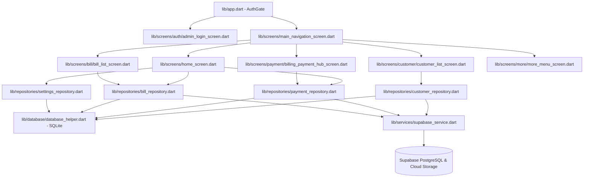

# ARSITEKTUR & REKAP FITUR APLIKASI WIFI MANAGER
> **Dokumentasi Pengembang & Referensi AI Agent / Developer**
> Berkas ini merangkum seluruh fitur, arsitektur modul, relasi data (CodeGraph/Entity Map), serta panduan integrasi jika ingin menambahkan fitur baru yang selaras dengan arsitektur saat ini.

---

## 1. PETA MODUL & RELASI KODE (CODEGRAPH ARCHITECTURE)

Struktur modul dirancang menggunakan pola **Clean Repository Pattern** yang mendukung **Hybrid Offline-First (SQLite) + Cloud Sync (Supabase)**:

---

## 2. REKAP SELURUH FITUR (FEATURE MATRIX)

### A. Autentikasi & Multi Admin (4 Admin)
* **File Terkait**:
  * `lib/models/admin_model.dart`
  * `lib/services/supabase_service.dart`
  * `lib/screens/auth/admin_login_screen.dart`
  * `lib/screens/admin/admin_management_screen.dart`
* **Fitur**:
  1. **Gerbang Masuk (`AuthGate`)**: Memproteksi seluruh layar. Jika belum terautentikasi, otomatis dialihkan ke layar login admin.
  2. **4 Akun Admin Bawaan**:
     * `Admin 1`: Super Admin (Owner)
     * `Admin 2`: Admin Keuangan & Kasir
     * `Admin 3`: Admin Lapangan & Teknisi
     * `Admin 4`: Admin Layanan & CS
  3. **Fitur "Ingat Saya"**: Menyimpan token login admin lokal via SQLite table `settings`.
  4. **Pencatatan Audit Trail**: Kolom `created_by_admin` dan `received_by_admin` mencatat nama admin penanggung jawab pada setiap tagihan dan pembayaran.

---

### B. Supabase Cloud Sync & Deployment Suga App
* **File Terkait**:
  * `lib/services/supabase_service.dart`
  * `lib/screens/settings/cloud_sync_screen.dart`
  * `supabase_schema.sql`
  * `Dockerfile`, `nginx.conf`, `build_web.ps1`
* **Fitur**:
  1. **Dual Storage (Offline SQLite & Online Supabase)**: Aplikasi tetap berjalan cepat secara lokal tanpa internet, dan menyinkronkan data secara otomatis saat online.
  2. **1-Klik Migrasi Cloud**: Fitur untuk mengekspor seluruh basis data lokal ke Supabase.
  3. **Tarik Data (Pull Sync)**: Mengunduh basis data cloud ke perangkat offline.
  4. **Siap Deploy ke Suga App (`suga.app`)**: Kontainerisasi multi-stage Docker + Nginx untuk versi web.

---

### C. Manajemen Pelanggan (Customer Management)
* **File Terkait**:
  * `lib/models/customer_model.dart`
  * `lib/repositories/customer_repository.dart`
  * `lib/screens/customer/`
* **Fitur**:
  1. **Pendaftaran Pelanggan**: ID otomatis/manual, nama, no HP/WhatsApp, alamat, pilihan paket.
  2. **Foto Dokumen / KTP**: Lampiran foto KTP untuk legalitas (disimpan ke memori internal atau bucket storage cloud).
  3. **Paket & Jatuh Tempo Dinamis**: Pengaturan tanggal mulai langganan dan tanggal jatuh tempo bulanan (due day).
  4. **Penerbitan Tagihan Awal**: Opsi langsung membuat tagihan pemasangan + pembayaran perdana saat daftar.

---

### D. Penagihan & Pembayaran (Billing & Payment)
* **File Terkait**:
  * `lib/models/bill_model.dart`, `lib/models/payment_model.dart`
  * `lib/repositories/bill_repository.dart`, `lib/repositories/payment_repository.dart`
  * `lib/screens/bill/`, `lib/screens/payment/`
* **Fitur**:
  1. **Auto Recurring Billing**: Generator tagihan berkala otomatis per 30 hari untuk pelanggan aktif.
  2. **Pembayaran Lunas & Cicilan (Parsial)**: Pencatatan nominal fleksibel yang otomatis menghitung sisa tagihan.
  3. **Multi Metode**: Tunai, Transfer Bank, E-Wallet.
  4. **Kuitansi Dual Format**:
     * Dokumen PDF A4/A5 resmi dengan logo kop usaha & tanda tangan.
     * Struk Thermal Bluetooth (58mm & 80mm) untuk printer kasir mini portabel.
  5. **Void / Batal Transaksi**: Rollback status pembayaran dengan pencatatan alasan pembatalan.

---

### E. Integrasi WhatsApp & Notifikasi Jatuh Tempo
* **File Terkait**:
  * `lib/utils/whatsapp_reminder_service.dart`
  * `lib/screens/due_reminders/due_reminder_screen.dart`
* **Fitur**:
  1. **Filter Jatuh Tempo**: Pengelompokan H-3, hari H, dan pelanggan menunggak.
  2. **Pesan Otomatis WhatsApp**: Membuka aplikasi WhatsApp langsung ke nomor pelanggan dengan template pesan tagihan lengkap tanpa perlu menyimpan kontak.

---

### F. Paket Layanan & Laporan Keuangan
* **File Terkait**:
  * `lib/models/package_model.dart`, `lib/repositories/package_repository.dart`
  * `lib/utils/excel_exporter.dart`, `lib/utils/sheets_exporter.dart`
  * `lib/screens/reports/reports_screen.dart`
* **Fitur**:
  1. **Paket Fleksibel**: Paket internet reguler bulanan dan paket event/hajatan (3 hari).
  2. **Laporan & Ekspor Data**: Rekapitulasi omset periodik yang dapat diekspor langsung ke berkas Excel (`.xlsx`) dan Spreadsheet (`.csv`).

---

## 3. PANDUAN UNTUK PENGEMBANG / AGENT SELANJUTNYA

Jika Anda ingin menambahkan fitur baru pada aplikasi ini, ikuti pedoman arsitektur berikut:

1. **Tambahkan Model di `lib/models/`**:
   Sediakan metode `toMap()`, `fromMap()`, dan `copyWith()`.
2. **Tambahkan Skema di SQLite & Supabase**:
   * SQLite: Tambahkan definisi tabel di `lib/database/database_helper.dart`.
   * Supabase: Tambahkan kueri DDL di `supabase_schema.sql`.
3. **Gunakan Pola Repository di `lib/repositories/`**:
   Lakukan operasi transaksi lokal di SQLite terlebih dahulu, kemudian picu sinkronisasi ke Supabase via `SupabaseService.instance` jika perangkat sedang online.
4. **Audit Admin**:
   Gunakan `SupabaseService.instance.currentAdmin.name` pada setiap record transaksi baru untuk mencatat nama admin pelaksana.
